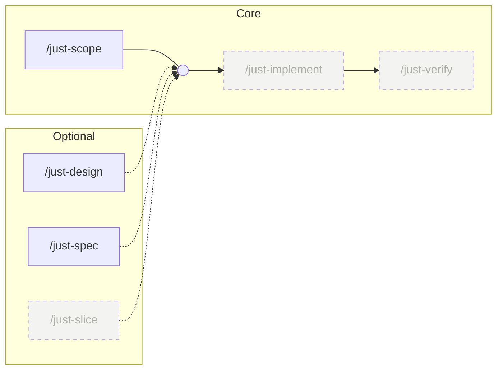

# Just Skills

**Just Skills is a lean collection of focused agent skills, built to stay small.**<br>
The aim is to make quality work easier. Every skill has to earn its place. Only what brings a clear benefit stays.

The main flow is just 3 skills: You talk with the model using `just-scope` to help it understand what you want, you ask it to implement the changes with `just-implement` and you ask it to verify its work and show you the proof with `just-verify`. 

The other skills are all optional, tailored to very specific situations.

Agent skills by [@aseeon](https://github.com/aseeon), installable with the [`skills`](https://www.skills.sh/) CLI.

---

## Install

To install every skill in this repo (recommended, as this repo is intentionally kept as small as possible):

```bash
npx skills add https://github.com/aseeon/just-skills
```

To install a chosen skill from the repo:

```bash
npx skills add https://github.com/aseeon/just-skills --skill chosen_skill
```

> The Skills CLI writes the skill into your agent's skills directory (`.claude/skills/` for Claude Code, and the equivalent path for other supported agents).

## Intended workflow



### Manually invokable skills

| # | Skill | What it does | When to use | Status |
|:-:|---|---|---|:-:|
| 1 | `/just-scope` | gather requirements through questioning and brainstorming | Always before you want to implement something | ✅ |
| 2 | `/just-design` | agree on UI/UX decisions and write a design document, with mockups when useful | Optionally, only if you have non-obvious UI/Visual design plan | ✅ |
| 4 | `/just-spec` | turn scope and any agreed design into technical specification | Optionally, only if you are handing the plan of implementation to non-frontier model | ✅ |
| 5 | `/just-slice` | break specification into tickets | Optionally, only if you need to keep track of the tickets yourself | 🚧 To be added |
| 6 | `/just-implement` | implement the tickets | Always, when you want to implement the planned scope | 🚧 To be added |
| 7 | `/just-verify` | verify implementation | Always, to verify your work | 🚧 To be added |

### Automatically applied helper skill

`/plainspeak` - make all the talking and output documents more pleasant

## Acknowledgments
These skills would not exist without the things i learned from the following human beings and their skills:
- [poteto](https://github.com/poteto)
- [obra](https://github.com/obra)
- [mattpocock](https://github.com/mattpocock)
- [Dammyjay93](https://github.com/Dammyjay93)
- Both Anthropic and OpenAI teams for their model guidance docs

## License

MIT. See [LICENSE](LICENSE).
